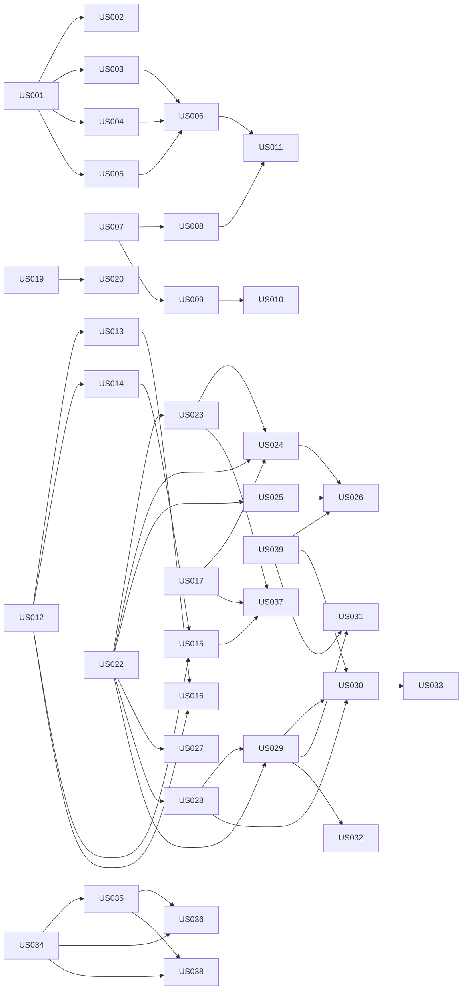

# User Stories: Rain-Adaptive Wiper Control System

**Source:** `docs/wiper_control_system_product_requirements.md` (PRD v1.0, draft for engineering review)
**Status:** Draft for requirement analysis. Stories are not approved requirements.
**Date:** 2026-10-27

## 1. How to read this document

### 1.1 Assumptions made while writing (please confirm)
The clarifying questions were not answered, so these defaults were applied. Each is a proposal, not a decision.

| # | Assumption | Impact if wrong |
|---|---|---|
| A1 | "S/M/L" means **story size (relative effort)**, not the S/M/L motor variants. Variant applicability is shown separately in the *Variant scope* field. | Re-size or split stories per variant. |
| A2 | Story granularity is close to one story per independently testable behavior, which may cover several `PR-xxx`. | Merge or split stories. |
| A3 | Personas: Driver, Software Engineer, Calibration Engineer, Safety Engineer, System Engineer. | Reword the "As a" lines. |
| A4 | Size definitions in 1.2 are a proposal for team calibration. No story points or durations are given. | Re-estimate during analysis. |

### 1.2 Size definitions (proposed)
| Size | Meaning |
|---|---|
| **S** | One behavior in one component, few acceptance criteria, no hardware dependency, no blocking open decision. |
| **M** | Several acceptance criteria or interfaces, depends on calibration data or on one or more open decisions, host or simulated testing is sufficient. |
| **L** | Spans several components, needs target-hardware evidence, safety/thermal analysis, or has multiple unresolved `TBD` inputs. |

### 1.3 Dependency types
- **Hard:** the story cannot be completed or accepted until the dependency is done.
- **Stub:** the story can be developed and tested in isolation with a stub, mock, or synthetic data in place of the dependency. Full integration is verified when the dependency is done.
- **Decision:** blocked or shaped by a PRD open question (`Q1`–`Q11`, PRD §12).

### 1.4 Independent testability
Every story has an **Independent test** field. It states how the story is verified without the other stories, using stubs, simulated inputs, or synthetic fixtures. Fixtures use synthetic data only (see AGENTS.md §13.1).

### 1.5 Rules applied
- Values the PRD marks `TBD` are written as `TBD` and are never filled in here.
- `ASIL: TBD` applies to every safety-relevant story until a hazard analysis is approved.
- "Verification IDs" are the PRD `VV-xxx` IDs. "none" means the PRD has no test case for that requirement (see section 5).

## 2. Story overview

| ID | Title | Size | Hard dependencies | Requirements | Verification |
|---|---|---|---|---|---|
| **Epic A: Driver input and modes** |||||
| US-001 | Driver input acquisition and debounce | S | none | PR-007 | none |
| US-002 | Invalid and contradictory driver input handling | M | US-001 | PR-006 | VV-003 (related) |
| US-003 | OFF mode | S | US-001 | PR-001, PR-005 | VV-001 |
| US-004 | Manual continuous mode | S | US-001 | PR-002 | VV-001 |
| US-005 | Manual intermittent mode | M | US-001 | PR-003 | VV-001 |
| US-006 | Mode arbitration and command priority | M | US-003, US-004, US-005 | PR-004, PR-005 | VV-001, VV-002 |
| **Epic B: Rain sensing and adaptive control** |||||
| US-007 | Rain sensor acquisition and calibrated intensity | M | none | PR-010 | VV-002 |
| US-008 | Rain sensor data validity detection | M | US-007 | PR-013 | VV-003 |
| US-009 | Intensity-to-wipe mapping | M | US-007 | PR-004, PR-011, PR-015 | VV-002 |
| US-010 | Mapping hysteresis, filtering and transitions | M | US-009 | PR-012 | VV-002 |
| US-011 | Invalid-sensor fallback and driver indication | M | US-008, US-006 | PR-014 | VV-003 |
| **Epic C: Real-time control and microcontroller** |||||
| US-012 | 500 Hz control task scheduling | M | none | PR-020 | VV-004 |
| US-013 | Control-task deadline and WCET evidence | L | US-012 | PR-021 | VV-004 |
| US-014 | Execution-time measurement and timing diagnostics | S | US-012 | PR-027 | none |
| US-015 | Watchdog supervision and overrun/lockup/reset behavior | L | US-012, US-014 | PR-026 | VV-009 |
| US-016 | Isolation of lower-priority functions | M | US-012, US-013 | PR-025, PR-034 | VV-005 |
| US-017 | Motor command generation through motor driver | L | none | PR-022 | none |
| US-018 | MCU selection against documented criteria | M | none (stub: US-013, US-019 estimates) | PR-023, PR-024 | none |
| **Epic D: Memory and persistent settings** |||||
| US-019 | Memory budget definition | M | none | PR-030, PR-031 | none |
| US-020 | Memory budget compliance and exhaustion handling | M | US-019 | PR-032 | VV-005 |
| US-021 | Persistent settings integrity, versioning and safe defaults | L | none | PR-033 | none |
| **Epic E: Motor variants, torque and drive limits** |||||
| US-022 | S/M/L variant parameter set definition | M | none (Decision: Q4) | PR-040, PR-041 | VV-006 |
| US-023 | Startup variant configuration validation | M | US-022 | PR-046 | VV-006 |
| US-024 | Torque, current and speed limit enforcement | L | US-022, US-023, US-017 | PR-042, PR-043 | VV-006, VV-007 |
| US-025 | Motor stall, overload and abnormal-current detection | M | US-022 | PR-044 | VV-007 |
| US-026 | Overload and stall protective response | M | US-025, US-024, US-039 | PR-045 | VV-007 |
| US-027 | Motor and linkage sizing verification | L | US-022 | PR-047 | none |
| **Epic F: Thermal management and duty cycle** |||||
| US-028 | Motor/driver temperature monitoring or thermal model | L | US-022 | PR-052 | VV-008 |
| US-029 | Calibrated thermal thresholds | M | US-028, US-022 | PR-054 | VV-008 |
| US-030 | Eight-hour duty-cycle and thermal policy | L | US-028, US-029, US-039 | PR-050, PR-051 | VV-008 |
| US-031 | Visibility-safe thermal protection response | M | US-029, US-039 | PR-055 | VV-010 |
| US-032 | Thermal protection recovery | S | US-029 | PR-056 | VV-010 |
| US-033 | Thermal design solution or component selection | M | US-030 | PR-053 | VV-008 |
| **Epic G: Diagnostics and fault handling** |||||
| US-034 | Fault catalogue | M | none | PR-060, PR-061 | none |
| US-035 | Fault detection reporting and recording | M | US-034 | PR-060 | VV-003, VV-007, VV-009 |
| US-036 | Documented fallback state | M | US-034, US-035 | PR-062 | VV-003 |
| US-037 | No unintended motor activation at startup, reset and brownout | L | US-017, US-015, US-023 | PR-063 | VV-009 |
| US-038 | Diagnostic reporting over the vehicle interface | M | US-034, US-035 | PR-064 | none |
| **Epic H: Enablers** |||||
| US-039 | Hazard analysis inputs for safety-relevant behavior | L | none (Decision: Q11) | PRD §10 (supports PR-026, PR-045, PR-051, PR-055) | none |
| US-040 | Requirement-to-verification traceability baseline | S | none | all PR-xxx, all VV-xxx | n/a |

**Size totals (proposed):** S = 6 (US-001, 003, 004, 014, 032, 040), M = 24, L = 10 (US-013, 015, 017, 021, 024, 027, 028, 030, 037, 039).

### 2.1 Dependency graph (hard dependencies only)

### 2.2 Suggested analysis order (proposal)
| Wave | Stories | Reason |
|---|---|---|
| 0 | US-039, US-040, US-034, US-022, US-019, US-018 | Decisions, catalogues and data definitions that other stories consume. |
| 1 | US-001, US-007, US-012, US-017, US-021 | Foundations with no hard dependencies. |
| 2 | US-002, US-003, US-004, US-005, US-008, US-009, US-014, US-023, US-035 | Build on wave 1. |
| 3 | US-006, US-010, US-011, US-015, US-020, US-024, US-025, US-028, US-036, US-038 | Integration of wave 2. |
| 4 | US-013, US-016, US-026, US-027, US-029, US-030, US-031, US-032, US-033, US-037 | Timing, thermal, safety and hardware evidence. |

## 3. Stories

Open decisions (`Q1`–`Q11`) refer to PRD §12:
Q1 supply voltage, Q2 rain sensor, Q3 scope of 500 Hz, Q4 S/M/L ratings, Q5 park/current/temperature feedback, Q6 driver controls, Q7 sensor-failure fallback, Q8 meaning of eight hours, Q9 hosted application, Q10 vehicle/diagnostic interface, Q11 environmental/safety/cybersecurity/regulatory.

---

## Epic A: Driver input and modes

### US-001: Driver input acquisition and debounce
- **Size:** S | **Variant scope:** All
- **Story:** As a Driver, I want my control selections read reliably without false changes, so that the wipers respond only to what I selected.
- **Requirements:** PR-007 | **Verification:** none in PRD (gap) | **ASIL:** TBD
- **Depends on:** none | **Decisions:** Q6
- **Acceptance criteria:**
  - Raw driver-input signals from the selected input hardware are acquired and converted to a debounced state.
  - A transient shorter than the debounce time is not reported as a state change.
  - A valid state change is reported within the response-time requirement (value: TBD, not defined in PRD).
- **Independent test:** feed synthetic input waveforms (clean, bouncing, glitching) to the input module; no motor or sensor needed.
- **Analysis inputs needed:** input hardware type, switch positions (Q6), response-time requirement.

### US-002: Invalid and contradictory driver input handling
- **Size:** M | **Variant scope:** All
- **Story:** As a Driver, I want faulty or contradictory switch signals handled safely, so that a damaged switch does not cause unintended wiping.
- **Requirements:** PR-006 | **Verification:** Fault injection (related VV-003 covers sensors only) | **ASIL:** TBD
- **Depends on:** Hard: US-001. Stub: US-035 (fault reporting)
- **Decisions:** Q6
- **Acceptance criteria:**
  - Contradictory, out-of-range, noisy, and unavailable driver-input states are each detected and classified as invalid.
  - On invalid input, a defined safe handling result is produced (behavior: TBD) and no unintended motor activation occurs.
  - Noisy input does not cause repeated mode changes.
- **Independent test:** inject each invalid pattern into the input module and assert the classification and the safe-handling output with a stubbed fault recorder.
- **Analysis inputs needed:** the list of contradictory combinations, and the approved safe handling result.

### US-003: OFF mode
- **Size:** S | **Variant scope:** All
- **Story:** As a Driver, I want OFF to stop the wipers, so that I control when wiping ends.
- **Requirements:** PR-001, PR-005 (OFF part) | **Verification:** VV-001 | **ASIL:** TBD
- **Depends on:** Hard: US-001. Stub: motor command output (US-017)
- **Decisions:** Q5 (park feedback), vehicle-specific park behavior
- **Acceptance criteria:**
  - When OFF is selected, no new wipe request is issued, regardless of sensor state or intermittent timing.
  - If a safe park sequence is required by the vehicle design, it completes before the motor stops; otherwise the motor stops with no park sequence.
  - OFF takes effect over any other active mode.
- **Independent test:** select OFF while each other mode is active (stubbed) and assert no new wipe requests; repeat with park required and not required.
- **Analysis inputs needed:** whether a park sequence is required and how park position is detected.

### US-004: Manual continuous mode
- **Size:** S | **Variant scope:** S, M, L (limits come from variant data)
- **Story:** As a Driver, I want a continuous-wipe setting, so that I get steady wiping in heavy rain.
- **Requirements:** PR-002 | **Verification:** VV-001 | **ASIL:** TBD
- **Depends on:** Hard: US-001. Stub: limit enforcement (US-024)
- **Decisions:** Q6
- **Acceptance criteria:**
  - Selecting continuous mode produces a wipe request at the approved continuous setting.
  - The request never exceeds the configured motor limits.
  - Leaving continuous mode ends the request according to the new mode.
- **Independent test:** drive the mode with synthetic input and a stubbed limit provider; assert the request value and the clamp.
- **Analysis inputs needed:** which continuous settings exist (for example one or several speeds) and their approved values.

### US-005: Manual intermittent mode
- **Size:** M | **Variant scope:** All
- **Story:** As a Driver, I want to set the time between wipes, so that wiping matches light rain.
- **Requirements:** PR-003 | **Verification:** VV-001 | **ASIL:** TBD
- **Depends on:** Hard: US-001
- **Decisions:** Q6
- **Acceptance criteria:**
  - Wipes are requested using the driver-selected configured interval.
  - Minimum and maximum interval values (TBD) are accepted and values outside the range are rejected or limited.
  - A change of interval during operation follows a defined rule (rule: TBD).
- **Independent test:** use a simulated clock and synthetic selections; assert wipe-request timestamps against each interval.
- **Analysis inputs needed:** interval range, resolution, control type (dial, steps, sensitivity), and the interval-change rule.

### US-006: Mode arbitration and command priority
- **Size:** M | **Variant scope:** All
- **Story:** As a Driver, I want my selection to always win over automatic behavior, so that the wipers act predictably.
- **Requirements:** PR-004, PR-005 | **Verification:** VV-001, VV-002 | **ASIL:** TBD
- **Depends on:** Hard: US-003, US-004, US-005. Stub: US-009 (automatic request), US-011 (fallback)
- **Decisions:** Q6
- **Acceptance criteria:**
  - A documented priority table defines which source controls the output for every mode and sensor-status combination in PRD §6.
  - The same inputs always give the same output (deterministic).
  - Driver OFF inhibits new wipe commands in every state.
  - Mode transitions are defined, including transitions into and out of automatic mode.
- **Independent test:** exhaustive table-driven test of mode x sensor-status combinations using stubbed request sources.
- **Analysis inputs needed:** approved mode list and the automatic-mode selection control.

---

## Epic B: Rain sensing and adaptive control

### US-007: Rain sensor acquisition and calibrated intensity
- **Size:** M | **Variant scope:** All
- **Story:** As a Calibration Engineer, I want raw rain-sensor data converted to a calibrated intensity level, so that downstream control uses a meaningful, repeatable value.
- **Requirements:** PR-010 | **Verification:** VV-002 | **ASIL:** TBD
- **Depends on:** none | **Decisions:** Q2, Q3
- **Acceptance criteria:**
  - Sensor data is acquired through the selected interface at the sensor update rate (TBD).
  - A calibrated intensity level is produced using calibration data held separately from the logic.
  - Units are explicit in names and interfaces.
- **Independent test:** replay recorded or synthetic sensor frames through the acquisition and calibration module; assert the intensity output.
- **Analysis inputs needed:** sensor model, interface, update rate, output format, and calibration data. None are defined in the PRD.

### US-008: Rain sensor data validity detection
- **Size:** M | **Variant scope:** All
- **Story:** As a Software Engineer, I want stale, out-of-range, implausible, or missing sensor data detected, so that bad data never drives the wipers.
- **Requirements:** PR-013 | **Verification:** VV-003 | **ASIL:** TBD
- **Depends on:** Hard: US-007. Stub: US-035
- **Decisions:** Q2
- **Acceptance criteria:**
  - Each of stale, out-of-range, implausible, and unavailable is detected and distinguished.
  - A validity status is published with every intensity value.
  - Detection thresholds (age, range, plausibility) come from approved data (TBD).
  - A defined rule determines when data is valid again after a fault.
- **Independent test:** inject each invalid pattern (frozen, disconnected, noisy, out-of-range) and assert status and fault report.
- **Analysis inputs needed:** sensor specification, plausibility criteria, and recovery rule.

### US-009: Intensity-to-wipe mapping
- **Size:** M | **Variant scope:** All (speed output is limited per variant)
- **Story:** As a Driver, I want automatic mode to wipe faster in heavier rain, so that visibility stays clear without my input.
- **Requirements:** PR-004, PR-011, PR-015 | **Verification:** VV-002 | **ASIL:** TBD
- **Depends on:** Hard: US-007. Stub: US-024 (limits)
- **Decisions:** Q2, Q6
- **Acceptance criteria:**
  - A calibrated table maps each intensity level to a wipe interval and/or speed command.
  - Intensity is never used directly as a speed command unless the calibration explicitly defines that relationship.
  - A sweep across all calibrated levels follows the approved mapping.
  - Output stays within motor limits.
- **Independent test:** sweep synthetic intensity levels through the mapping with calibration fixtures and a stubbed limit provider.
- **Analysis inputs needed:** whether the mapping outputs interval, speed, or both, and the approved calibration values.

### US-010: Mapping hysteresis, filtering and transitions
- **Size:** M | **Variant scope:** All
- **Story:** As a Driver, I want automatic wiping to change smoothly, so that it does not flicker between speeds.
- **Requirements:** PR-012 | **Verification:** VV-002 | **ASIL:** TBD
- **Depends on:** Hard: US-009
- **Decisions:** Q2
- **Acceptance criteria:**
  - Thresholds, hysteresis, filtering, and transition behavior are defined as calibration parameters.
  - Intensity dithering around a threshold does not cause repeated speed or interval changes.
  - Transitions between levels follow the defined behavior.
- **Independent test:** feed dithering and step intensity sequences to the mapping and count output changes against the allowed behavior.
- **Analysis inputs needed:** calibrated parameters and the acceptable change rate.

### US-011: Invalid-sensor fallback and driver indication
- **Size:** M | **Variant scope:** All
- **Story:** As a Driver, I want a defined safe behavior when the rain sensor fails, so that I am not left without wiping control or surprised by erratic wiping.
- **Requirements:** PR-014 | **Verification:** VV-003 | **ASIL:** TBD
- **Depends on:** Hard: US-008, US-006. Stub: US-038 (indication)
- **Decisions:** Q7, Q10, Q11
- **Acceptance criteria:**
  - When sensor data is invalid in automatic mode, the approved fallback is entered.
  - Uncontrolled operation is avoided.
  - A driver indication is given through the available vehicle interface only if one is supported.
  - Return to normal automatic behavior follows an approved recovery rule.
- **Independent test:** hold the sensor status invalid with a stubbed sensor module and indication output; assert the fallback output and the indication request.
- **Analysis inputs needed:** the fallback behavior (not defined in the PRD) and whether a driver indication channel exists.

---

## Epic C: Real-time control and microcontroller

### US-012: 500 Hz control task scheduling
- **Size:** M | **Variant scope:** All
- **Story:** As a Software Engineer, I want the control task to run every 2 ms, so that sensing and control meet the timing target.
- **Requirements:** PR-020 | **Verification:** VV-004 (Timing measurement) | **ASIL:** TBD
- **Depends on:** none | **Decisions:** Q3, Q9
- **Acceptance criteria:**
  - The designated high-priority task runs with a 2 ms period.
  - Period and jitter are measured; the jitter limit is TBD.
  - The scope of "500 Hz" is recorded as an assumption until Q3 is answered (PRD assumes the control task).
- **Independent test:** run the task on the target (or a timing-accurate simulation) with an empty workload and measure period and jitter.
- **Analysis inputs needed:** MCU/RTOS choice, jitter limit, confirmation of the 500 Hz scope.

### US-013: Control-task deadline and WCET evidence
- **Size:** L | **Variant scope:** All
- **Story:** As a Software Engineer, I want evidence that the task finishes within 2 ms in the worst case, so that no deadline is missed.
- **Requirements:** PR-021 | **Verification:** VV-004 (WCET analysis / Stress test) | **ASIL:** TBD
- **Depends on:** Hard: US-012. Integration evidence needs the control stories to exist.
- **Decisions:** Q9
- **Acceptance criteria:**
  - The worst-case workload is defined and approved.
  - Measured or analytically justified WCET is reported under that workload.
  - An engineering-approved timing margin is applied (value: TBD).
  - No timing compliance is claimed without that evidence.
- **Independent test:** execute the task under the defined worst-case workload on target hardware and record the maximum execution time.
- **Analysis inputs needed:** definition of worst-case workload, margin, and target hardware.

### US-014: Execution-time measurement and timing diagnostics
- **Size:** S | **Variant scope:** All
- **Story:** As a Software Engineer, I want task execution time measured and exposed, so that timing problems are visible during development and, where feasible, in the field.
- **Requirements:** PR-027 | **Verification:** none in PRD (gap) | **ASIL:** TBD
- **Depends on:** Hard: US-012
- **Decisions:** production exposure to be decided (PRD: "where feasible")
- **Acceptance criteria:**
  - Execution time per cycle, maximum, and overrun count are measured.
  - Values are available for development and, where feasible, in production.
  - The measurement overhead is bounded and accounted for in the timing budget.
- **Independent test:** run the task with known synthetic delays and assert reported values.
- **Analysis inputs needed:** how and where timing data is exposed in production.

### US-015: Watchdog supervision and overrun, lockup and reset behavior
- **Size:** L | **Variant scope:** All
- **Story:** As a Safety Engineer, I want the control task supervised, so that overrun, lockup, or reset leads to a defined safe result.
- **Requirements:** PR-026 | **Verification:** VV-009 | **ASIL:** TBD
- **Depends on:** Hard: US-012, US-014. Stub: US-035
- **Decisions:** Q11, MCU watchdog capability (US-018)
- **Acceptance criteria:**
  - The watchdog is serviced only by healthy task execution.
  - Defined behavior exists for task overrun, lockup, and watchdog reset.
  - The motor output is in a defined state during and after a watchdog reset.
  - Reset cause is recorded.
  - Fault reaction time (value: TBD) is measured.
- **Independent test:** inject overrun and lockup into the task; observe the reset, motor-output state, and recorded reset cause.
- **Analysis inputs needed:** safe-state definition, fault-reaction-time requirement, and watchdog hardware.

### US-016: Isolation of lower-priority functions
- **Size:** M | **Variant scope:** All
- **Story:** As a Software Engineer, I want supporting and optional functions unable to disturb the control task, so that real-time control is always protected.
- **Requirements:** PR-025, PR-034 | **Verification:** VV-005 | **ASIL:** TBD
- **Depends on:** Hard: US-012, US-013
- **Decisions:** Q9
- **Acceptance criteria:**
  - Lower-priority work cannot block the control task.
  - Scheduling and resource controls prevent optional workloads from causing deadline misses.
  - With the supporting workload running, zero deadline misses are observed and memory budgets hold.
- **Independent test:** run synthetic worst-case lower-priority load alongside the control task and count deadline misses.
- **Analysis inputs needed:** which supporting or optional workloads exist and their CPU, RAM, and flash needs.

### US-017: Motor command generation through the motor driver
- **Size:** L | **Variant scope:** S, M, L
- **Story:** As a Software Engineer, I want motor commands generated for the selected motor driver, so that the control decisions become actual motor behavior.
- **Requirements:** PR-022 | **Verification:** none in PRD (gap; PRD lists Integration test as method) | **ASIL:** TBD
- **Depends on:** none. Stub: motor driver HAL, limits (US-024)
- **Decisions:** Q1, Q5, motor driver part number (TBD)
- **Acceptance criteria:**
  - Commands are generated through an interface compatible with the selected motor driver.
  - Feedback signals are used where the selected control strategy requires them.
  - All outputs initialize to an inactive state.
  - Sensor-to-command latency requirement is recorded (value: TBD, PRD §7).
- **Independent test:** drive the command layer against a simulated motor-driver HAL; assert output signals for each commanded state.
- **Analysis inputs needed:** motor driver part, control strategy, feedback availability, latency requirement.

### US-018: MCU selection against documented criteria
- **Size:** M | **Variant scope:** All
- **Story:** As a System Engineer, I want the MCU chosen against documented criteria, so that the selected part is justified.
- **Requirements:** PR-023, PR-024 | **Verification:** none in PRD (Design review) | **ASIL:** TBD
- **Depends on:** Stub: US-013 (WCET estimate), US-019 (memory budget). **Decisions:** Q1, Q9, Q11
- **Acceptance criteria:**
  - Candidate Renesas and TI MCUs are assessed against every criterion in PRD §9.
  - The decision record states the evidence and any gaps.
  - No part number is assumed before the assessment.
- **Independent test:** design-review checklist applied to the decision record; no software needed.
- **Analysis inputs needed:** peripheral needs, safety capability required by the vehicle safety concept (Q11), candidate datasheets.

---

## Epic D: Memory and persistent settings

### US-019: Memory budget definition
- **Size:** M | **Variant scope:** All
- **Story:** As a Software Engineer, I want RAM and flash budgets defined, so that the application stays within the chosen MCU's limits.
- **Requirements:** PR-030, PR-031 | **Verification:** none in PRD (Static analysis / Review; Integration test for PR-030) | **ASIL:** TBD
- **Depends on:** none | **Decisions:** Q9
- **Acceptance criteria:**
  - Budgets cover code, stack, heap (if used), calibration data, diagnostics, and persistent settings.
  - The MCU is confirmed to host the control software and any approved supporting functions.
  - The budget is approved by engineering.
- **Independent test:** review of the budget document; static analysis of an initial build confirms the budget categories can be measured.
- **Analysis inputs needed:** the list of hosted functions and MCU memory capacity.

### US-020: Memory budget compliance and exhaustion handling
- **Size:** M | **Variant scope:** All
- **Story:** As a Software Engineer, I want the application checked against its budget and safe on memory exhaustion, so that memory problems never cause unsafe motor behavior.
- **Requirements:** PR-032 | **Verification:** VV-005 | **ASIL:** TBD
- **Depends on:** Hard: US-019
- **Decisions:** none beyond US-019
- **Acceptance criteria:**
  - Measured RAM, flash, and stack use are compared with the budget on every build.
  - Memory exhaustion and corrupted configuration are handled safely with a defined response (TBD).
- **Independent test:** build-time map-file check plus stress test with injected memory pressure and corrupted configuration.
- **Analysis inputs needed:** approved budget and the safe response definition.

### US-021: Persistent settings integrity, versioning and safe defaults
- **Size:** L | **Variant scope:** All
- **Story:** As a System Engineer, I want persistent settings protected and versioned, so that corrupted or outdated data cannot cause unsafe operation.
- **Requirements:** PR-033 | **Verification:** none in PRD (gap; PRD lists Test / Review) | **ASIL:** TBD
- **Depends on:** none. Stub: storage medium
- **Decisions:** storage medium and integrity mechanism (TBD, not in PRD)
- **Acceptance criteria:**
  - Stored settings carry an approved integrity mechanism and a version.
  - Corruption or a version mismatch results in safe defaults.
  - Safe defaults never allow unrestricted motor operation.
  - Interrupted writes (power loss) leave a valid or default state.
- **Independent test:** corrupt, truncate, and version-shift stored data in a simulated store; assert the loaded values.
- **Analysis inputs needed:** which settings persist, the medium, and the safe default values (TBD).

---

## Epic E: Motor variants, torque and drive limits

### US-022: S/M/L variant parameter set definition
- **Size:** M | **Variant scope:** S, M, L
- **Story:** As a System Engineer, I want an approved parameter set per variant, so that limits come from supplier data and never from the label alone.
- **Requirements:** PR-040, PR-041 | **Verification:** VV-006 | **ASIL:** TBD
- **Depends on:** none | **Decisions:** Q4 (blocking), Q1
- **Acceptance criteria:**
  - A schema covers every PRD §8 parameter.
  - Each variant set is populated only from approved supplier and vehicle data.
  - A missing or unapproved parameter marks the set invalid.
  - Variant data is separate from control logic.
- **Independent test:** validate synthetic complete, incomplete, and out-of-range sets against the schema.
- **Analysis inputs needed:** supplier ratings for S, M, and L (all `TBD` in PRD §8).

### US-023: Startup variant configuration validation
- **Size:** M | **Variant scope:** S, M, L
- **Story:** As a Safety Engineer, I want the selected variant configuration validated at startup, so that a wrong or corrupted configuration never runs the motor unrestricted.
- **Requirements:** PR-046 | **Verification:** VV-006 | **ASIL:** TBD
- **Depends on:** Hard: US-022. Stub: US-021 (integrity), US-035
- **Decisions:** how the variant is selected (not defined in PRD)
- **Acceptance criteria:**
  - The selected variant and its parameter set are checked for completeness, range, and integrity before the motor is enabled.
  - Invalid or unsupported configuration leads to a restricted or disabled state (exact state: TBD).
  - Each S, M, and L set is accepted when valid.
- **Independent test:** startup test with valid sets for S, M, and L and with synthetic invalid sets; assert the resulting state.
- **Analysis inputs needed:** variant selection mechanism and the restricted-state definition.

### US-024: Torque, current and speed limit enforcement
- **Size:** L | **Variant scope:** S, M, L
- **Story:** As a Safety Engineer, I want the motor kept inside its approved envelope, so that it is never driven beyond manufacturer limits.
- **Requirements:** PR-042, PR-043 | **Verification:** VV-006, VV-007 | **ASIL:** TBD
- **Depends on:** Hard: US-022, US-023, US-017
- **Decisions:** Q5 (current feedback), Q1
- **Acceptance criteria:**
  - Commands are limited to the selected variant's torque, current, and speed limits.
  - Available feedback is used; behavior when feedback is unavailable is defined (TBD).
  - Commanded operating points stay inside the manufacturer's envelope for each variant.
- **Independent test:** command out-of-envelope requests against each variant parameter set (synthetic) and assert clamped outputs; confirm on target with feedback.
- **Analysis inputs needed:** validated limits, feedback availability.

### US-025: Motor stall, overload and abnormal-current detection
- **Size:** M | **Variant scope:** S, M, L
- **Story:** As a Software Engineer, I want stall and overload detected, so that the motor is protected from damage.
- **Requirements:** PR-044 | **Verification:** VV-007 | **ASIL:** TBD
- **Depends on:** Hard: US-022. Stub: US-035
- **Decisions:** Q5
- **Acceptance criteria:**
  - Stall, overload, and abnormal current are detected when the sensing hardware is available.
  - Detection thresholds come from the variant parameter set.
  - If sensing hardware is not available, the limitation is documented.
- **Independent test:** inject synthetic current profiles for each condition per variant and assert detection and the fault report.
- **Analysis inputs needed:** thresholds, detection time (TBD), sensing hardware.

### US-026: Overload and stall protective response
- **Size:** M | **Variant scope:** S, M, L
- **Story:** As a Safety Engineer, I want a defined response to stall or overload, so that damage and hazards are limited.
- **Requirements:** PR-045 | **Verification:** VV-007 | **ASIL:** TBD
- **Depends on:** Hard: US-025, US-024, US-039. Stub: US-035
- **Decisions:** Q11, response defined by safety analysis
- **Acceptance criteria:**
  - The approved response (for example limit drive, stop, or both) is applied on detection.
  - A diagnostic record is made.
  - Recovery conditions are defined and tested.
- **Independent test:** inject a detected-overload event and assert the motor command, record, and recovery behavior.
- **Analysis inputs needed:** the approved response and recovery conditions.

### US-027: Motor and linkage sizing verification
- **Size:** L | **Variant scope:** S, M, L
- **Story:** As a System Engineer, I want each variant's sizing verified against worst-case loads, so that torque limits are credible.
- **Requirements:** PR-047 | **Verification:** none in PRD (Engineering analysis / Test) | **ASIL:** TBD
- **Depends on:** Hard: US-022
- **Decisions:** Q1, Q4, Q11
- **Acceptance criteria:**
  - Analysis covers friction, aerodynamic and water load, ice or obstruction assumptions, supply voltage, and environmental conditions.
  - A margin result is reported per variant.
- **Independent test:** review of the analysis and the supporting test report.
- **Analysis inputs needed:** assumed load cases and supplier data. This is an engineering analysis story, not a software story.

---

## Epic F: Thermal management and duty cycle

### US-028: Motor/driver temperature monitoring or thermal model
- **Size:** L | **Variant scope:** S, M, L
- **Story:** As a Safety Engineer, I want motor and driver temperature known, so that thermal protection acts on real conditions.
- **Requirements:** PR-052 | **Verification:** VV-008 | **ASIL:** TBD
- **Depends on:** Hard: US-022
- **Decisions:** Q5
- **Acceptance criteria:**
  - Temperature is read directly, or a thermal model is used where sensing is unavailable.
  - A thermal model is validated against measured data.
  - Temperature validity and plausibility are reported.
- **Independent test:** feed synthetic sensor or load profiles to the monitor or model; assert temperature output and validity.
- **Analysis inputs needed:** sensing availability and model validation data.

### US-029: Calibrated thermal thresholds
- **Size:** M | **Variant scope:** S, M, L
- **Story:** As a Safety Engineer, I want warning, derating, and shutdown thresholds set from component data, so that protection starts at justified levels.
- **Requirements:** PR-054 | **Verification:** VV-008 | **ASIL:** TBD
- **Depends on:** Hard: US-028, US-022
- **Decisions:** Q11
- **Acceptance criteria:**
  - Thresholds per variant derive from component specifications and the vehicle safety analysis.
  - Crossing each threshold triggers the defined state transition.
- **Independent test:** ramp a synthetic temperature through all thresholds and assert the state transitions.
- **Analysis inputs needed:** component thermal ratings (`TBD` in PRD §8).

### US-030: Eight-hour duty-cycle and thermal policy
- **Size:** L | **Variant scope:** S, M, L
- **Story:** As a System Engineer, I want the eight-hour constraint implemented as a validated duty-cycle policy, so that it protects components without creating a visibility hazard.
- **Requirements:** PR-050, PR-051 | **Verification:** VV-008 | **ASIL:** TBD
- **Depends on:** Hard: US-028, US-029, US-039
- **Decisions:** Q8 (blocking), Q11
- **Acceptance criteria:**
  - The meaning of "eight hours" (continuous energization, cumulative operation, or a duty-cycle profile) is approved first.
  - The policy is implemented as a duty-cycle/thermal policy, not an arbitrary shutdown.
  - Operation beyond eight hours is allowed only where the motor, driver, and thermal design are validated for it.
- **Independent test:** accelerated simulated-time test of the policy; target thermal test through the approved profile.
- **Analysis inputs needed:** the Q8 definition and the approved operating profile.

### US-031: Visibility-safe thermal protection response
- **Size:** M | **Variant scope:** S, M, L
- **Story:** As a Driver, I want thermal protection to avoid suddenly losing wiping, so that my visibility stays safe.
- **Requirements:** PR-055 | **Verification:** VV-010 (related) | **ASIL:** TBD
- **Depends on:** Hard: US-029, US-039
- **Decisions:** Q10, Q11
- **Acceptance criteria:**
  - The response in each active mode is defined by a documented hazard assessment.
  - Abrupt loss of wiping does not occur without that assessment.
  - A driver notification is given if the vehicle interface supports it.
- **Independent test:** hold overtemperature in each active mode with stubbed thermal input; assert the output matches the approved response.
- **Analysis inputs needed:** the hazard assessment result.

### US-032: Thermal protection recovery
- **Size:** S | **Variant scope:** S, M, L
- **Story:** As a Driver, I want normal wiping to resume only when it is safe, so that the motor is not damaged by early restart.
- **Requirements:** PR-056 | **Verification:** VV-010 | **ASIL:** TBD
- **Depends on:** Hard: US-029. Stub: US-038
- **Decisions:** Q10
- **Acceptance criteria:**
  - Recovery occurs only when approved recovery conditions are met.
  - Recovery does not occur earlier than those conditions.
- **Independent test:** lower a synthetic temperature through and below the recovery condition; assert the recovery moment.
- **Analysis inputs needed:** approved recovery conditions.

### US-033: Thermal design solution or component selection
- **Size:** M | **Variant scope:** S, M, L
- **Story:** As a System Engineer, I want a thermal solution or rated components chosen when the duty cycle exceeds ratings, so that the required operation is sustainable.
- **Requirements:** PR-053 | **Verification:** VV-008 (Thermal analysis) | **ASIL:** TBD
- **Depends on:** Hard: US-030
- **Decisions:** Q4, Q8
- **Acceptance criteria:**
  - If the required duty exceeds ratings, an approved heat-dissipation solution or suitably rated components are selected.
  - A decision record documents the result per variant.
- **Independent test:** review of thermal analysis and test results.
- **Analysis inputs needed:** thermal analysis results from US-030. Not a software story.

---

## Epic G: Diagnostics and fault handling

### US-034: Fault catalogue
- **Size:** M | **Variant scope:** All
- **Story:** As a Safety Engineer, I want every fault defined with its detection, severity, response, recovery, and indication, so that fault handling is complete and testable.
- **Requirements:** PR-060, PR-061 | **Verification:** none in PRD (Review / Test) | **ASIL:** TBD
- **Depends on:** none (inputs from US-039) | **Decisions:** Q7, Q10, Q11
- **Acceptance criteria:**
  - The catalogue includes at least the PRD list: sensor failure, motor overload or stall, overtemperature, invalid configuration, watchdog reset, and control-task overrun, where applicable.
  - Each entry has detection condition, severity, response, recovery condition, and diagnostic indication.
  - Entries marked `TBD` are listed as open items, not guessed.
- **Independent test:** review checklist: every entry is complete; every PRD-listed fault has an entry.
- **Analysis inputs needed:** severity scheme and hazard analysis outputs.

### US-035: Fault detection reporting and recording
- **Size:** M | **Variant scope:** All
- **Story:** As a Software Engineer, I want one place to report and record faults, so that all detectors act consistently.
- **Requirements:** PR-060 | **Verification:** VV-003, VV-007, VV-009 (as injection targets) | **ASIL:** TBD
- **Depends on:** Hard: US-034
- **Decisions:** record retention and storage (TBD)
- **Acceptance criteria:**
  - Fault events from detectors are accepted, classified per the catalogue, and recorded.
  - Recorded faults can be read back.
  - Retention rules are defined (TBD).
- **Independent test:** inject synthetic fault events and assert records and classification.
- **Analysis inputs needed:** retention and storage decisions.

### US-036: Documented fallback state
- **Size:** M | **Variant scope:** All
- **Story:** As a Driver, I want the system to enter a known fallback state when critical inputs or control are lost, so that behavior is predictable.
- **Requirements:** PR-062 | **Verification:** VV-003 | **ASIL:** TBD
- **Depends on:** Hard: US-034, US-035
- **Decisions:** Q7, Q11
- **Acceptance criteria:**
  - Each fault with a fallback response maps to a documented fallback state.
  - Entry and exit conditions are defined.
  - Motor behavior in each fallback state is defined.
- **Independent test:** inject each critical-input loss with stubs and assert the state and motor output.
- **Analysis inputs needed:** fallback state definitions.

### US-037: No unintended motor activation at startup, reset and brownout
- **Size:** L | **Variant scope:** All
- **Story:** As a Driver, I want the wipers never to move unexpectedly when the system starts, resets, or loses power briefly, so that unintended wiping cannot occur.
- **Requirements:** PR-063 | **Verification:** VV-009 | **ASIL:** TBD
- **Depends on:** Hard: US-017, US-015, US-023
- **Decisions:** Q1, Q11, brownout thresholds (TBD)
- **Acceptance criteria:**
  - The motor output is inactive from reset until initialization and validation complete.
  - No activation occurs during startup, watchdog reset, brownout, or configuration failure.
  - Brownout detection and response are defined where supported by the MCU.
- **Independent test:** fault injection on target and in simulation; monitor the motor-driver output for every injected condition.
- **Analysis inputs needed:** brownout thresholds and electrical architecture.

### US-038: Diagnostic reporting over the vehicle interface
- **Size:** M | **Variant scope:** All
- **Story:** As a System Engineer, I want diagnostics reported through the selected vehicle interface, so that faults are visible to service and the vehicle.
- **Requirements:** PR-064 | **Verification:** none in PRD (Integration test) | **ASIL:** TBD
- **Depends on:** Hard: US-034, US-035
- **Decisions:** Q10 (blocking). No protocol is assumed.
- **Acceptance criteria:**
  - Reporting uses the interface selected in the system architecture.
  - Content follows the fault catalogue.
  - No interface or protocol outside the approved architecture is added.
- **Independent test:** run against a simulated vehicle interface once the interface is chosen.
- **Analysis inputs needed:** the vehicle interface and diagnostic protocol.

---

## Epic H: Enablers

### US-039: Hazard analysis inputs for safety-relevant behavior
- **Size:** L | **Variant scope:** All
- **Story:** As a Safety Engineer, I want the hazards analyzed, so that protective responses and safe states are based on approved safety goals.
- **Requirements:** PRD §10 (supports PR-026, PR-045, PR-051, PR-055) | **Verification:** none | **ASIL:** TBD (not assigned here)
- **Depends on:** none | **Decisions:** Q11
- **Acceptance criteria:**
  - Hazards include loss of wiping, unintended wiping, sensor failure, and thermal shutdown (from PRD §10).
  - Outputs state the safe behavior for each, or list open items.
  - No ASIL is assigned without approved analysis.
- **Independent test:** review by a qualified safety engineer; not a software test.
- **Analysis inputs needed:** vehicle context and applicable standards.

### US-040: Requirement-to-verification traceability baseline
- **Size:** S | **Variant scope:** n/a
- **Story:** As a System Engineer, I want every requirement mapped to stories and tests, so that gaps are visible before design starts.
- **Requirements:** all PR-xxx and VV-xxx | **Verification:** n/a | **ASIL:** n/a
- **Depends on:** none
- **Acceptance criteria:**
  - Each PR-xxx maps to at least one story.
  - Each PR-xxx maps to a VV-xxx or is listed as a gap.
  - Gaps are reported, not hidden.
- **Independent test:** run a script or checklist over this file and the PRD; assert no unmapped PR-xxx.
- **Analysis inputs needed:** none.

---

## 4. Requirement coverage

| Requirement | Story | Requirement | Story | Requirement | Story |
|---|---|---|---|---|---|
| PR-001 | US-003 | PR-023 | US-018 | PR-047 | US-027 |
| PR-002 | US-004 | PR-024 | US-018 | PR-050 | US-030 |
| PR-003 | US-005 | PR-025 | US-016 | PR-051 | US-030 |
| PR-004 | US-006, US-009 | PR-026 | US-015 | PR-052 | US-028 |
| PR-005 | US-003, US-006 | PR-027 | US-014 | PR-053 | US-033 |
| PR-006 | US-002 | PR-030 | US-019 | PR-054 | US-029 |
| PR-007 | US-001 | PR-031 | US-019 | PR-055 | US-031 |
| PR-010 | US-007 | PR-032 | US-020 | PR-056 | US-032 |
| PR-011 | US-009 | PR-033 | US-021 | PR-060 | US-034, US-035 |
| PR-012 | US-010 | PR-034 | US-016 | PR-061 | US-034 |
| PR-013 | US-008 | PR-040 | US-022 | PR-062 | US-036 |
| PR-014 | US-011 | PR-041 | US-022 | PR-063 | US-037 |
| PR-015 | US-009 | PR-042 | US-024 | PR-064 | US-038 |
| PR-020 | US-012 | PR-043 | US-024 | | |
| PR-021 | US-013 | PR-044 | US-025 | | |
| PR-022 | US-017 | PR-045 | US-026 | | |
| | | PR-046 | US-023 | | |

All 46 PR-xxx requirements in the PRD map to at least one story.

## 5. Gaps found during story creation (for requirement analysis)

1. **PRD requirements with no VV-xxx test case:** PR-007, PR-015 (partly VV-002), PR-022, PR-023, PR-024, PR-027, PR-030, PR-031, PR-033, PR-047, PR-053 (partly VV-008), PR-060, PR-061, PR-064. Recommend adding test cases or confirming the PRD verification column is sufficient.
2. **PRD content with no PR-xxx ID, so not story-backed:** electrical protection (reverse polarity, transients, load dump, ESD, brownout; §10), environmental validation (temperature, vibration, humidity, water ingress, EMC; §10), field-of-view validation (§10), sensor-to-command latency (§7). Decide whether to add requirement IDs.
3. **Mechanism for selecting the S/M/L variant is not defined** in the PRD (affects US-022, US-023).
4. **Missing definitions that block acceptance criteria:** driver-input response time, jitter limit, timing margin, safe default values, restricted-state behavior, record retention. All are `TBD` here.
5. **Blocking open questions:** Q4 (US-022 and all variant stories), Q8 (US-030), Q10 (US-038), Q2 (Epic B), Q7 (US-011), Q11 (US-039 and safety stories).
6. **No requirement addresses driver-input fault recovery or brownout thresholds**; both appear in acceptance criteria as `TBD`.

## 6. Approval
These stories are a draft for requirement analysis. They do not change the PRD and are not an approved baseline.
